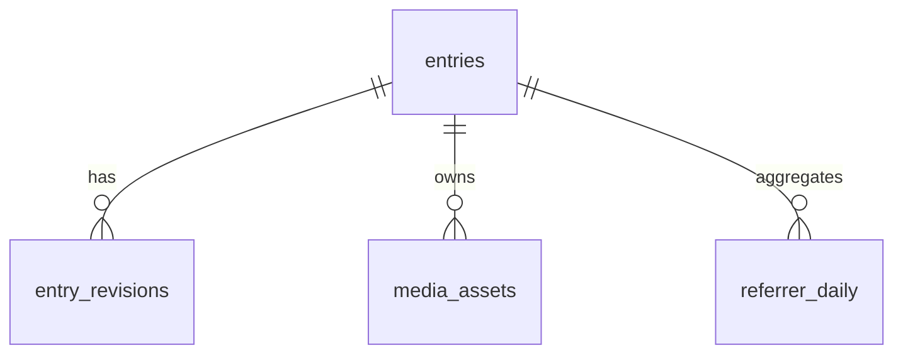

# Database design (current D1 schema)

This document describes the **implemented schema**, reconstructed from `drizzle/0000_initial.sql` through `0005_media_deletion_fence.sql`. Those migration files remain the authoritative DDL. `docs/DESIGN.md` contains an earlier illustrative proposal, not a complete current schema. No migration should be inferred from this document.

## Storage and ownership

- **Cloudflare D1 (SQLite)** is the operational source of truth for articles, append-only revisions, mutation replay records, media metadata and optional referrer statistics.
- **Private R2 bucket `MEDIA`** stores media bytes. `media_assets.storage_key` locates the R2 object; media bytes do not live in D1.
- Article mutation APIs require trusted owner authorization. Reader queries filter publication status and audience **server-side**. D1/R2 bindings are configured separately by the Site.
- IDs are application-generated strings. Timestamps are stored as text (UTC ISO-8601 by convention), and reader dates are displayed in Asia/Tokyo.

## Tables

| Table | Primary key | Main columns | Relationships and purpose |
| --- | --- | --- | --- |
| `entries` | `id` | `slug` (unique), `status`, `visibility`, `latest_revision`, `published_revision`, `created_at`, `updated_at`, `published_at` | Article identity, audience and lifecycle |
| `entry_revisions` | (`entry_id`, `revision`) | `title`, `body_md`, `summary`, `tags_json`, `saved_at`, `hero_media_id`, `hero_alt_text` | Immutable saved article revisions; `entry_id` references `entries.id` |
| `mutation_requests` | `request_id` | `operation`, `response_json`, `created_at` | Idempotency ledger: replay a committed result for the same operation, reject request-ID reuse for another operation |
| `media_assets` | `id` | `entry_id`, `storage_key` (unique), `content_type`, `byte_size`, `original_name`, `created_at` | Media metadata; `entry_id` references `entries.id`, `storage_key` maps to R2 |
| `referrer_daily` | (`day`, `entry_id`, `source_host`) | `hits` | Optional aggregated referral counts; `entry_id` references `entries.id` |
| `members` | `user_id` | `registered_at`, `tier`, `active`, `paid_active`, `paid_until`, `updated_at` | Historical membership schema; registration, payment and membership features are currently disabled |

Relationship overview:

`entry_revisions.hero_media_id` contains a media ID but **has no SQL foreign-key constraint**. `mutation_requests` and `members` have no SQL foreign key to `entries`.

## Constraints and indexes

- `entries.status`: `draft` or `published`; draft rows require `published_revision IS NULL`, and published rows require it to be non-null. `latest_revision >= 1`; publication pointer must be positive when set.
- `entries.visibility`: schema allows `owner`, `paid`, `registered`, `public` for historical compatibility, but **current application operations support only `owner` and `public`**.
- `entry_revisions.revision >= 1`; each article/revision pair is unique. `tags_json` is JSON stored as text, not a separate tags table.
- `media_assets.byte_size > 0`; `referrer_daily.hits >= 0`; membership `active` and `paid_active` are 0/1 and `tier` is `registered` or `paid`.
- Indexes: `idx_entries_public(status, published_at DESC)`, `idx_revisions_entry(entry_id, revision DESC)`, `idx_referrer_day(day)`, `idx_media_entry(entry_id)`, `idx_entry_revisions_hero_media(hero_media_id)`. The primary keys and unique slug/storage key also create uniqueness constraints.

## Lifecycle and revision semantics

1. **Create draft:** insert `entries` with `status=draft`, `visibility=owner`, `latest_revision=1`, `published_revision=NULL`; insert revision 1.
2. **Save changes:** append `entry_revisions` at `latest_revision + 1`, and update `entries.latest_revision` with an expected-revision guard. Prior revisions are retained.
3. **Publish:** explicit `publish_entry` selects the **latest** saved revision only; update `status=published`, `visibility`, `published_revision`, and publication timestamps. Never infer a broader audience merely from a save.
4. **Already published:** reader routes render the **latest saved revision**, not `published_revision`, subject to current audience restrictions. A subsequent save/hero edit is immediately visible to the existing authorized audience. `published_revision` records the last explicit publish operation and remains a legacy/history pointer.
5. **Unpublish:** reset status to draft, visibility to owner, clear `published_revision` and `published_at`; preserve revision history.
6. **Delete draft:** restricted to never-published private drafts under a revision precondition; related data and R2 bytes are removed using guarded operations. A published entry cannot use this route.

Do not interpret `published_revision` as a frozen snapshot: the current reader joins use `latest_revision` (`lib/reader-store.ts`). An authorization or publication-status change must remain effective immediately.

## Media consistency and an implementation caveat

`lib/media-store.ts` writes bytes to R2, then registers the `media_assets` row in D1, attempting cleanup if the D1 insert fails. URL and ChatGPT-image upload paths perform subsequent revision/idempotency operations and attempt to remove unused assets after errors or duplicate submissions. Because D1 and R2 are separate stores, these steps are **not a single cross-store atomic transaction**; review failure and retry paths when changing the implementation.

Public media reads in `lib/media-store.ts` check whether the media is referenced by the **current `latest_revision`** of a published, public article. `lib/media-deletion.ts` atomically claims unreferenced media in D1 before removing R2 bytes. The `0005` triggers reject new article references or publication using a claimed asset; abandoned claims can be retried after 15 minutes. This cannot make D1 and R2 one transaction, so unconfirmed R2 errors retain a claim until safe retry. Regression tests cover an older `published_revision` pointer.

## Migration order

Apply the files only in their designed order on a **new test database**:

1. `0000_initial.sql` — entries, entry_revisions, mutation_requests
2. `0001_referrers.sql` — aggregated referrers
3. `0002_article_access.sql` — visibility and legacy members
4. `0003_media.sql` — media metadata
5. `0004_hero_media.sql` — per-revision hero fields
6. `0005_media_deletion_fence.sql` — in-progress R2 deletion claims and D1 triggers that prevent new media references

The `ALTER TABLE` migrations are not meant to be rerun blindly. **Do not reapply migrations, reseed or recreate production D1** as part of documentation or source deployment.

## Sources

- DDL: [`drizzle/`](../drizzle/)
- Article write/idempotency operations: [`lib/store.ts`](../lib/store.ts)
- Reader visibility: [`lib/reader-store.ts`](../lib/reader-store.ts), [`lib/access.ts`](../lib/access.ts)
- Media: [`lib/media-store.ts`](../lib/media-store.ts), [`lib/media-deletion.ts`](../lib/media-deletion.ts)
- Product and access policy: [`docs/REQUIREMENTS.md`](REQUIREMENTS.md), [`docs/ARTICLE_ACCESS.md`](ARTICLE_ACCESS.md), [`docs/PUBLIC_ROLLOUT.md`](PUBLIC_ROLLOUT.md)
