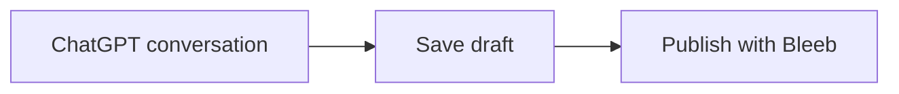

# Using Bleeb

1. **Use ChatGPT as usual.** Ask questions, research topics, and discuss ideas.
2. **Save something when it is worth keeping.** Just say, “Save this as a draft in Bleeb.”
3. **Revise it as needed.** Ask ChatGPT to rewrite or polish the article, edit the text yourself, or use Bleeb’s browser editor. Save the changes when you are ready.
4. **Add a cover image if you like.** Generate an image in ChatGPT and ask it to set the image as the article’s cover (hero) image. Generated images can be around **2–4 MB**, so consider asking ChatGPT to compress or convert them to **WebP** first.
5. **Publish explicitly.** Once you have reviewed the article, say, “Publish this article.” You can still edit it or unpublish it later.

**Important:** Saving a new draft does not publish it. However, edits to an *already published* article become visible to its current audience immediately. Create a separate draft if you need to work privately on major changes.

## Rich articles

Bleeb renders rich content from **ordinary Markdown**. You can ask ChatGPT to write it for you, or paste these examples into the browser editor. Always preview before publishing.

### Tables, code and math

Use standard GitHub-flavored Markdown tables:

```markdown
| Feature | Status |
| --- | --- |
| Mermaid | Supported |
| Charts | Supported |
```

For colored source code, specify a language such as `python`, `typescript`, `bash` or `sql`:

````markdown
```python
print('Hello from Bleeb')
```
````

Math uses KaTeX syntax: inline `$E=mc^2$`, or a display equation:

````markdown
$$
E = mc^2
$$
````

### Mermaid diagrams

Use a fenced `mermaid` block. For example:

````markdown

````

### Chart.js charts

Use `chart` followed by JSON. Chart types: `bar`, `line`, `pie`, `doughnut`.

````markdown
```chart
{
  "type": "bar",
  "title": "Posts per month",
  "labels": ["July", "August", "September"],
  "datasets": [{"label": "Posts", "data": [3, 5, 4]}]
}
```
````

The chart is interactive, and a data table is provided beneath it. Only validated chart JSON is accepted; it does not execute JavaScript.

### YouTube, X and stock charts

Paste the **YouTube video ID**, not the full URL:

````markdown
```youtube
dQw4w9WgXcQ
```
````

For an X post, use its numeric post ID:

````markdown
```x
1234567890123456789
```
````

For a **TradingView** stock chart, use an exchange-qualified ticker:

````markdown
```stock
NASDAQ:AAPL
```
````

YouTube and X embeds wait for the reader to click before loading third-party content. The stock chart is browser-lazy-loaded but may contact TradingView without a click. Availability depends on those external services.

### Table of contents and footnotes

Bleeb automatically adds a collapsible table of contents when an article contains at least two level-2 or level-3 headings:

```markdown
## Introduction
An overview of the topic.

### Background
Details that appear in the table of contents.

## Conclusion
Key takeaways.
```

Add footnotes using standard Markdown notation:

```markdown
Bleeb stores articles in D1.[^storage]

[^storage]: Images and videos are stored separately in R2.
```

### Images and videos

Upload your image or video through ChatGPT or the owner editor. Then insert the media URL returned by Bleeb:

```markdown


```

Replace the placeholders with real media IDs (UUIDs) from your own article. A video uses the `video:` prefix inside the image alt text. **Cover images are set separately** through Bleeb's hero-image action; an upload alone does not publish the file.

### Other Markdown formatting

```markdown
> A useful quote from the discussion.

**Bold**, *italic*, and [a source link](https://example.com).

- A bullet point
- Another bullet point
```

See [Article embeds](ARTICLE_EMBEDS.md) for format limits and rendering details.

## Browser editor

- `/owner/new` — create a draft.
- `/owner/archive` — browse private drafts and revision history.
- `/owner/archive/{id}/edit` — edit, preview, publish, or unpublish.
- `/owner/media?entry_id={id}` — manage article media.

Owner authentication is required. Article data is stored in D1 and media in private R2. Media uploads alone do not make files public.

For backups, use `export_entries` or the owner's note-compatible text export. Full cross-Site restore is not yet verified.

[Installation](GETTING_STARTED.md) · [Architecture](DESIGN.md)
